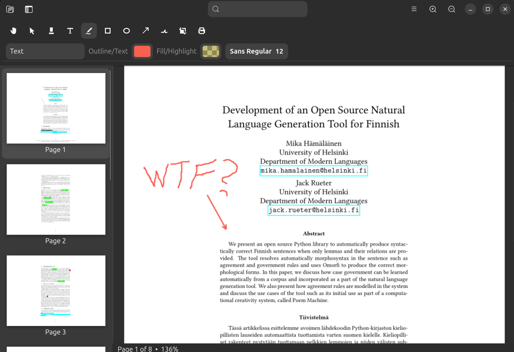

# Review

**A friendly PDF and image viewer for Linux, inspired by macOS Preview.**

Review is for people who want to open a PDF, sign it, mark it up, rearrange its
pages, or make a quick image edit without reaching for a large office suite.
It is a native GNOME application designed to feel at home on Ubuntu and other
modern Linux desktops.



If you have used Preview on a Mac, the idea should feel familiar: open a
document and do the everyday work right there. Review brings that kind of
simple, focused workflow to Linux.

## The short version

With Review, you can:

- Read PDFs and common image files.
- Scroll naturally from one PDF page to the next.
- Highlight text and add text, freehand drawings, shapes, and arrows.
- **Draw your signature once, save it, and reuse it whenever you need to sign a
  PDF.**
- Import a photographed or scanned signature and automatically remove its
  near-white background.
- Move, resize, recolor, or delete annotations before saving.
- Reorder, duplicate, rotate, remove, copy, and paste PDF pages.
- Bring pages in from another PDF.
- Turn ordinary PDF pages into 300 DPI, full-color image-only pages so they
  look like scanned pages.
- Securely crop a page by rebuilding it without the content outside the area
  you keep.
- Save normal editable annotations or export a flattened copy.

Review is free and open-source software, licensed under
[GPL-3.0-or-later](LICENSE).

## Install Review

### Add the repo

First follow the one-time instructions on:

**[mikakalevi.com/repo](https://mikakalevi.com/repo)**

### Install

Once the repository has been added to your computer, install Review with:

```sh
sudo apt install review
```

Review will then appear in your desktop's application menu. You can launch it
like any other app, or open a supported PDF or image with Review from your file
manager.

Installing from the repository also means future versions can arrive through
your normal system updates.


### System requirements

- Ubuntu 24.04 or newer
- A 64-bit Intel or AMD computer (`amd64`)
- A GNOME-compatible Linux desktop

Version 0.1 is currently packaged for Ubuntu `amd64`. Packages for additional
distributions and processor architectures may follow later.

## Getting started

1. Open **Review** from your application menu.
2. Choose **Open…** from the menu and select a PDF or image.
3. Use the page thumbnails on the left to move through a PDF.
4. Use the tools above the document to annotate, sign, or crop it.
5. Choose **Save** to update the document or **Save As…** to create another
   copy.

You can also start Review by double-clicking a file associated with it, or by
right-clicking a PDF in your file manager and choosing **Open With Review**.

Each document opens in its own window. This makes it easy to keep two PDFs
side by side or move pages between documents.

## Signing PDFs — one of Review's best features

Signing a form should not require printing it, finding a pen, scanning it, and
turning it back into a PDF. Review lets you keep a reusable visual signature
inside the app.

### Draw and save your signature

1. Open Review's main menu.
2. Choose **Draw Signature…**
3. Draw in the signature area with a mouse, touch screen, or stylus.
4. Save it.

Your signature is now available for future documents. You only need to draw it
once.

### Import an existing signature

Already have a picture of your signature? Choose **Import Signature…** and
select the image. Review makes the near-white background transparent so the
signature sits naturally on top of the PDF instead of appearing inside a
white rectangle.

A dark signature on clean white paper gives the best result. A phone photo
works too, especially when it is evenly lit and tightly cropped.

### Add the signature to a PDF

1. Open the PDF you want to sign.
2. Select the signature button in the annotation toolbar.
3. Review places the saved signature on the current page.
4. Switch to the selection tool to move it into position or resize it.
5. Save the PDF or use **Save As…** to preserve the original.

The signature is stored as a visual PDF stamp with its own appearance, so it
continues to look like your signature in other standard PDF viewers.

> **Important:** this is a visual signature, like placing an image of ink on a
> document. It is not a certificate-backed cryptographic or legally verified
> digital signature. Whether a visual signature is suitable depends on the
> document and the organization receiving it.

### Where signatures are kept

Saved signatures are stored for your Linux user account under:

```text
$XDG_DATA_HOME/review/signatures
```

When `XDG_DATA_HOME` is not customized, this normally means:

```text
~/.local/share/review/signatures
```

Review protects the directory and files with owner-only filesystem
permissions. The files are not encrypted, so anyone who has full access to
your user account or backups may still be able to see them. Treat your Linux
login and backups accordingly.

## Annotating a PDF

Review includes a focused set of annotation tools:

- **Highlight** for drawing attention to an area.
- **Text** for adding editable text with a chosen font, size, and color.
- **Freehand ink** for handwriting, sketching, or circling something quickly.
- **Rectangle and ellipse** with configurable outline and fill colors.
- **Arrow** for pointing to a specific part of the page.
- **Signature** for placing your reusable visual signature.

Click an annotation tool once and it stays active, allowing you to add several
annotations in a row. This is useful when highlighting many passages or adding
several arrows.

Use the **hand tool** when you only want to move around the page without
creating annotations. Use the **selection tool** to select an annotation, move
it, resize it from its corner handle, edit its text, or change its colors and
opacity. Press `Delete` while an annotation is selected to remove that
annotation.

Your most recently used annotation colors, opacity, and font choices are
remembered for the next annotation.

### Editable and flattened copies

A normal save keeps supported annotations as PDF annotations. Other PDF
viewers can display them, and compatible annotations can remain editable.

Choose **Export Flattened Copy…** when you want the visible result permanently
painted into the page. Flattening is useful when sending a finished copy to
someone whose PDF software handles annotations poorly. Keep your editable
original if you may want to change the annotations later.

## Moving through a document

The thumbnail sidebar gives you an overview of the document. Click a thumbnail
to jump to that page.

You can also stay in the main view and keep scrolling:

- At the bottom of a page, scroll down again to open the next page.
- At the top of a page, scroll up again to open the previous page.

This works with mouse wheels and touchpads. The sidebar selection and page
counter follow the page shown in the main view.

Use the zoom buttons to make the page larger or smaller. **Fit Width** adjusts
the page to the available width of the window.

## Organizing PDF pages

The thumbnail sidebar is not only for navigation. It is also where you can
organize a PDF.

Select one or more thumbnails and use the **Pages** menu to:

- Cut or copy pages.
- Paste pages after the current selection.
- Duplicate pages.
- Delete pages.
- Rotate pages left or right.
- Convert selected pages to scanned pages.
- Securely crop selected pages.

Use `Ctrl` while clicking to select individual pages. Use `Shift` to select a
range. You can drag selected pages to reorder them, move pages between open
Review windows, or drop a PDF into the sidebar to import its pages.

There is also an **Import PDF Pages…** command in the main menu. This is handy
for combining several PDFs into one document without using a separate PDF
merging tool.

## Convert to Scanned Page

Sometimes a PDF needs to behave like a scan rather than a digital text
document. Review's **Convert to Scanned Page** command replaces the selected
pages with 300 DPI, full-color images.

The result:

- Keeps the visible colors of the page.
- Bakes visible Review annotations into the page image.
- Removes searchable text from the converted page.
- Removes links, forms, and other interactive PDF content from that page.
- Looks like a color scan without forcing the output into grayscale.

This is a destructive transformation of the selected pages. Review warns
before overwriting the original, and **Save As…** is the safest choice when you
want to keep the original digital PDF too.

Converting a page to a scanned page is not OCR. Review does not add recognized
text back to the resulting image-only page.

## Secure Crop

Ordinary PDF cropping can merely hide content outside the visible crop box.
That hidden material may still remain inside the file.

Review's **Secure Crop** takes a stricter approach: it renders only the area you
choose and builds a new page of that size. Material outside the retained
rectangle is absent from the rebuilt page rather than simply hidden.

This is useful when the information you need to remove is entirely outside a
rectangular area you want to keep. It is not a general black-box redaction tool
for removing several unrelated pieces of content in the middle of a page.

Because secure crop permanently removes page content, consider saving to a new
file first.

## Images

Review can open common raster image formats supported by the Linux image
libraries, including PNG, JPEG, WebP, TIFF, BMP, and GIF. Images respect their
stored orientation information.

The image view supports the same simple, document-focused experience: zoom,
pan, rotate, crop, and export without opening a full image editor.

## Saving safely

Review writes PDF changes to a temporary file, checks the result, and then
replaces the destination. If saving fails or is cancelled, the original file
is left untouched.

Undo and redo are available while the document remains open. Closing a
document ends that editing session, so save a separate copy before
experimenting with destructive operations.

Password-protected PDFs and PDFs containing cryptographic signatures are
opened as view-only documents. Rewriting such files could remove encryption or
invalidate an existing digital signature.

PDF forms can be displayed, but form editing is not currently part of Review
0.1.

## Keyboard shortcuts

| Action | Shortcut |
| --- | --- |
| Open | `Ctrl+O` |
| Save | `Ctrl+S` |
| Save As | `Ctrl+Shift+S` |
| Undo | `Ctrl+Z` |
| Redo | `Ctrl+Shift+Z` |
| Copy selected pages | `Ctrl+C` |
| Cut selected pages | `Ctrl+X` |
| Paste pages | `Ctrl+V` |
| Zoom in | `Ctrl++` |
| Zoom out | `Ctrl+-` |
| Print | `Ctrl+P` |
| New window | `Ctrl+N` |
| Quit | `Ctrl+Q` |

## Updating or removing Review

When Review was installed from the software repository, it is updated through
Ubuntu's normal package updates.

To remove the application:

```sh
sudo apt remove review
```

Removing the package does not automatically delete your saved signatures or
personal configuration.

## Troubleshooting

### Review does not appear in the application menu

Log out and back in if your desktop has not refreshed its application list
after installation. You can also confirm that Review starts by running:

```sh
/usr/bin/review
```

### A file opens in another PDF viewer

Right-click the file, choose **Open With**, and select **Review**. Most file
managers also offer an option to remember the choice as the default for that
file type.

### A signature has a visible background

Try importing a version with dark ink on a clean, evenly lit white background.
Crop away shadows and unrelated objects before importing it.

### A recipient cannot see annotations correctly

Use **Export Flattened Copy…** and send the flattened copy. Keep the normal
saved version for your own future editing.

### The original PDF must remain unchanged

Use **Save As…** or **Export Flattened Copy…** and choose a different filename.
This is especially important before using Secure Crop or Convert to Scanned
Page.

## For developers and contributors

You do not need any of the following instructions to use Review. This section
is for people who want to build the application from source or contribute to
its development.

Review is written in C++20 and uses GTK4, libadwaita, Poppler, Cairo,
GdkPixbuf, qpdf, Meson, and debhelper.

### Build from source on Ubuntu

Install the build dependencies:

```sh
sudo apt install build-essential meson ninja-build pkg-config \
  libgtk-4-dev libadwaita-1-dev libpoppler-glib-dev libcairo2-dev \
  libgdk-pixbuf-2.0-dev qpdf
```

Configure and compile:

```sh
meson setup build
meson compile -C build
```

Run the tests:

```sh
meson test -C build --print-errorlogs
```

Run the locally built application without installing it:

```sh
./build/src/review
```

### Build the Debian package

```sh
sudo apt build-dep .
dpkg-buildpackage -us -uc -b
```

The package name and command-line executable are both `review`. Files supplied
on the command line open in their own Review windows:

```sh
review document.pdf picture.png
```

Bug reports and contributions are welcome. When reporting a problem, include
your Ubuntu version, the steps that reproduce it, and—when possible—a small
sample file that does not contain private information.

## Project information

- Application ID: `io.github.mika.Review`
- Package and executable: `review`
- Author: [Mika Hämäläinen](https://mikakalevi.com)
- License: [GPL-3.0-or-later](LICENSE)

Review is an independent Linux application inspired by the convenience of
macOS Preview. It is not affiliated with Apple.
